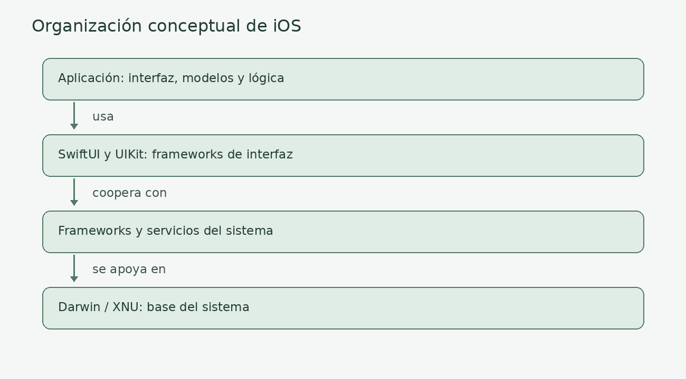
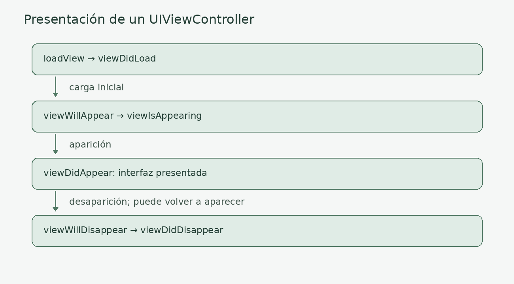
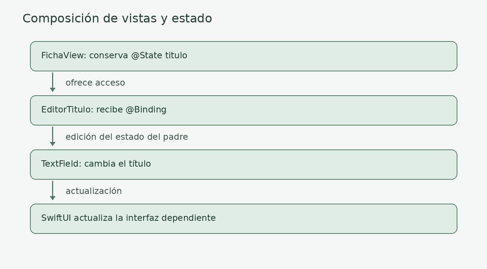
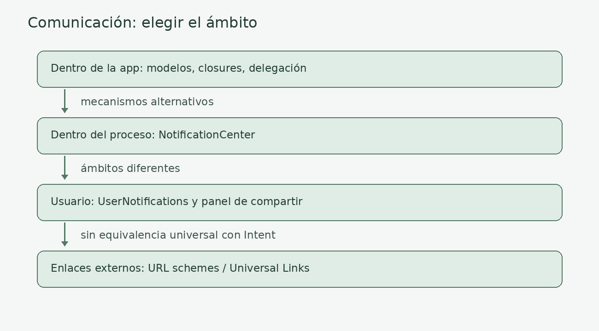
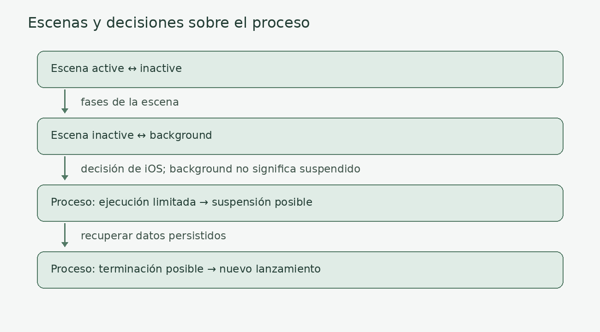

# Arquitectura base y componentes del sistema iOS

## Introducción

Una aplicación iOS reúne una interfaz, un estado y una lógica que cooperan bajo las reglas del sistema operativo. iOS decide cuándo la aplicación puede interactuar con el usuario, cuándo dispone de tiempo de ejecución y cuándo debe liberar recursos. Comprender estas decisiones permite diseñar aplicaciones que mantienen sus datos y responden correctamente a las interrupciones.

En este tema emplearemos **SwiftUI como hilo conductor**, y explicaremos **UIKit** para comprender los controladores, las interfaces imperativas y la integración con proyectos existentes. Swift es el lenguaje; SwiftUI y UIKit son frameworks de interfaz. No son dos lenguajes diferentes.

Los ejemplos que utilizan Observation y la versión de `onChange` con dos parámetros requieren **iOS 17 o posterior**. Son ejemplos didácticos independientes: no deben copiarse todos en un mismo proyecto como si constituyeran una aplicación completa. Cuando se muestra solo una parte de una configuración, se indica expresamente.

---

## Arquitectura de una aplicación iOS

Conviene separar dos preguntas: qué servicios ofrece el sistema y cómo organizamos nuestro código. Las capas del sistema no son las capas del patrón MVVM.

Podemos representar el entorno de una aplicación mediante cuatro niveles didácticos:

1. **Aplicación:** vistas, estado, modelos y servicios que implementan sus funcionalidades.
2. **Frameworks de interfaz:** SwiftUI y UIKit proporcionan herramientas para construir interfaces y responder a interacciones.
3. **Frameworks y servicios del sistema:** Foundation, URLSession, almacenamiento, gráficos y otros recursos. Algunas de estas APIs cooperan con procesos y servicios externos al proceso de la app.
4. **Base del sistema:** Darwin, con el kernel XNU, los controladores y los mecanismos de memoria, procesos y seguridad.



*Imagen. Organización didáctica del sistema; las dependencias reales no forman una cadena estricta.*

Las aplicaciones de terceros están aisladas mediante un **sandbox**. Acceden a sus propios archivos y a recursos autorizados mediante APIs, permisos y capacidades. Una extensión puede ejecutarse en un proceso distinto. Por tanto, el paquete instalado no equivale a un único proceso permanente.

iOS puede suspender una aplicación en segundo plano y terminar su proceso para recuperar recursos. El estado que debe sobrevivir al cierre necesita almacenamiento persistente; conservarlo en una propiedad Swift no basta.

---

## Piezas fundamentales de una aplicación iOS

iOS no posee una lista de componentes que reproduzca exactamente la de Android. Estudiaremos sus mecanismos por responsabilidad: entrada y escenas, interfaz, composición, trabajo en segundo plano, eventos e intercambio de datos.

### App y Scene: entrada y organización de la experiencia

**Definición:** en el ciclo de vida de SwiftUI, un tipo que adopta `App` describe la aplicación. Su propiedad `body` declara escenas. Una `Scene` organiza una instancia de la experiencia de interfaz; `WindowGroup` declara un grupo de ventanas administrado por el sistema.

Una escena no es simplemente una pantalla de navegación. Una ventana puede contener muchas pantallas, y una app puede tener varias escenas, especialmente en iPadOS cuando admite múltiples ventanas.

```swift
import SwiftUI

@main
struct BibliotecaApp: App {
    var body: some Scene {
        WindowGroup {
            InicioView()
        }
    }
}

struct InicioView: View {
    var body: some View {
        NavigationStack {
            Text("Mi biblioteca")
                .navigationTitle("Inicio")
        }
    }
}
```

**Funciones principales:** definir el punto de entrada, organizar escenas y proporcionar dependencias compartidas con un alcance explícito. Un modelo creado a nivel de `App` puede compartirse entre ventanas; un estado creado dentro de la vista raíz puede pertenecer a una instancia de escena.

**En UIKit:** `UIApplication` coordina la aplicación; `UIApplicationDelegate` atiende eventos del proceso, como el lanzamiento. En proyectos con escenas, `UISceneDelegate` responde a conexión y cambios de actividad de cada escena. Las responsabilidades dependen del ciclo de vida configurado en el proyecto.

SwiftUI gestiona gran parte de esta coordinación. Si una integración necesita un delegado de UIKit, `@UIApplicationDelegateAdaptor` permite incorporarlo al ciclo de vida de SwiftUI. No es necesario añadir manualmente `SceneDelegate` a toda aplicación SwiftUI.

**Buenas prácticas:** mantener ligera la inicialización, inyectar dependencias y distinguir estado de aplicación, de escena y de vista. No confiar en un callback de terminación para guardar datos esenciales.

<details>
<summary>Metáfora: el edificio y sus salas</summary>
<p>La aplicación es un edificio. Cada escena es una sala que puede abrirse, quedar temporalmente sin atención o cerrarse. Las vistas son los elementos que organizamos dentro de una sala. Dos salas pueden usar el mismo catálogo, pero tener una selección distinta. Del mismo modo, dos ventanas pueden compartir datos y conservar estados de navegación independientes.</p>
</details>

### View en SwiftUI: interfaz declarativa y estado

**Definición:** un tipo que adopta `View` describe una parte de la interfaz. Habitualmente es una estructura. Su `body` expresa qué debe mostrarse para un estado determinado; SwiftUI gestiona la actualización de la interfaz.

```swift
import SwiftUI

struct ContadorView: View {
    @State private var contador = 0

    var body: some View {
        VStack(spacing: 16) {
            Text("Pulsaciones: \(contador)")
            Button("Incrementar") {
                contador += 1
            }
        }
        .padding()
    }
}
```

**Flujo:** la interacción modifica el estado; SwiftUI evalúa las dependencias afectadas y actualiza la representación visual. No se debe interpretar cada evaluación de `body` como la creación de una pantalla nueva.

**Mecanismos principales:**

| Mecanismo | Responsabilidad |
|---|---|
| `@State` | Almacenar estado local asociado a la identidad de la vista. |
| `@Binding` | Permitir a una vista acceder al estado cuyo propietario está fuera de ella. |
| `@Environment` | Leer valores o dependencias disponibles en el entorno. |
| `@Observable` | Hacer observable un modelo con el framework Observation. |
| `@Bindable` | Obtener bindings a propiedades de un modelo observable. |

En proyectos que usan `ObservableObject`, aparecen `@Published`, `@StateObject` y `@ObservedObject`. Son un modelo de observación distinto; no deben mezclarse mecánicamente con Observation.

**Eventos y tareas:** `onAppear` y `onDisappear` permiten responder a aparición y desaparición. Pueden ejecutarse varias veces y no representan todos los estados de una app. `.task` inicia trabajo asíncrono asociado a la vida de la vista; SwiftUI solicita su cancelación cuando la vista desaparece. El trabajo debe cooperar con la cancelación. `.task(id:)` también cancela y reinicia la tarea si cambia el identificador.

**Buenas prácticas:** mantener `body` libre de efectos secundarios, evitar operaciones costosas en él y conservar el estado según su propietario. La identidad de la vista determina la continuidad de su estado; su desaparición no significa necesariamente que el proceso termine.

### UIViewController en UIKit: coordinación de una interfaz

**Definición:** `UIViewController` administra una jerarquía de objetos `UIView`, coordina interacciones y responde a cambios de presentación. Es útil compararlo con ciertas responsabilidades de una Activity, pero no es una equivalencia exacta.

**Callbacks habituales:**

| Método | Momento y uso habitual |
|---|---|
| `loadView()` | Crea o carga la vista raíz; se sobrescribe cuando se construye manualmente. |
| `viewDidLoad()` | La jerarquía está cargada; permite configurar elementos. |
| `viewWillAppear(_:)` | La vista va a incorporarse a la jerarquía visible. |
| `viewIsAppearing(_:)` | La vista está entrando en la jerarquía; útil para actualizaciones con geometría y entorno disponibles. |
| `viewDidAppear(_:)` | Ha completado la aparición. |
| `viewWillDisappear(_:)` | Va a desaparecer de la presentación. |
| `viewDidDisappear(_:)` | Ha completado la desaparición. |



*Imagen. Secuencia simplificada sin transiciones interactivas canceladas; un controlador puede aparecer varias veces.*

Estos eventos describen la presentación de una vista, no el ciclo de ejecución del proceso. Ir a segundo plano no debe tratarse como una llamada garantizada a `viewDidDisappear`. `deinit` es la finalización de una instancia Swift cuando se libera; no es un callback de pantalla ni se garantiza antes de terminar el proceso.

```swift
import UIKit

final class SaludoViewController: UIViewController {
    override func viewDidLoad() {
        super.viewDidLoad()
        view.backgroundColor = .systemBackground

        let etiqueta = UILabel()
        etiqueta.text = "Hola desde UIKit"
        etiqueta.translatesAutoresizingMaskIntoConstraints = false
        view.addSubview(etiqueta)

        NSLayoutConstraint.activate([
            etiqueta.centerXAnchor.constraint(equalTo: view.centerXAnchor),
            etiqueta.centerYAnchor.constraint(equalTo: view.centerYAnchor)
        ])
    }

    override func viewWillAppear(_ animated: Bool) {
        super.viewWillAppear(animated)
        // Actualizaciones necesarias antes de mostrar la interfaz.
    }
}
```

**Buenas prácticas:** invocar `super` al sobrescribir callbacks que lo requieren, separar presentación y negocio, gestionar observadores y evitar ciclos de referencias. No introducir descargas bloqueantes en `viewDidLoad`.

<details>
<summary>Metáfora: preparar y abrir una exposición</summary>
<p>Cargar la vista equivale a montar una exposición. Antes de abrir sus puertas se revisa la presentación; después entran los visitantes. Cuando la sala deja de mostrarse, puede permanecer montada para otra visita. Ocultar la exposición no implica destruir el edificio: del mismo modo, ocultar una vista no termina la app ni libera automáticamente su controlador.</p>
</details>

### Composición y contenedores

**En SwiftUI:** dividir una pantalla consiste en combinar vistas pequeñas. `VStack`, `HStack` y `ZStack` organizan elementos; `TabView` y `NavigationStack` estructuran experiencias de navegación. Una subvista puede recibir datos y bindings sin convertirse en un componente con un ciclo de vida Android.

```swift
import SwiftUI

struct EditorTitulo: View {
    @Binding var titulo: String

    var body: some View {
        TextField("Título", text: $titulo)
            .textFieldStyle(.roundedBorder)
    }
}

struct FichaView: View {
    @State private var titulo = "Bioinformática"

    var body: some View {
        VStack {
            EditorTitulo(titulo: $titulo)
            Text("Título actual: \(titulo)")
        }
        .padding()
    }
}
```



*Imagen. La vista padre conserva el estado; la vista hija recibe acceso mediante un binding.*

**En UIKit:** `UINavigationController`, `UITabBarController` y `UISplitViewController` administran otros controladores. Un contenedor personalizado debe respetar el protocolo de contención (`addChild`, incorporación de la vista y `didMove(toParent:)`, junto con los pasos correspondientes al retirar el hijo).

**Interoperabilidad:** `UIHostingController` aloja SwiftUI en UIKit; `UIViewRepresentable` y `UIViewControllerRepresentable` permiten integrar vistas y controladores UIKit en SwiftUI. No hay que reconstruir toda una app para incorporar el otro framework.

**Relación con inflar:** UIKit puede cargar interfaces de storyboard o archivos XIB y crear objetos en memoria; es una comparación útil con la inflación de XML en Android. SwiftUI declara vistas en código y deja al framework gestionar su representación. Crear una jerarquía y dibujar sus píxeles son operaciones distintas.

### Trabajo asíncrono y ejecución en segundo plano

**Definición:** el trabajo asíncrono permite esperar operaciones sin bloquear la interfaz. La ejecución en segundo plano es el permiso del sistema para trabajar cuando la app deja de estar activa. Son conceptos distintos.

`async/await` y `Task` no conceden por sí mismos tiempo de ejecución cuando iOS suspende el proceso. Tampoco garantizan que todo el código se ejecute fuera del actor principal.

| Necesidad | Mecanismo habitual |
|---|---|
| Esperar una respuesta mientras se usa la app | Concurrencia Swift y `URLSession`. |
| Actualizar contenido oportunistamente | `BGAppRefreshTask`. |
| Procesamiento aplazable | `BGProcessingTask`. |
| Transferencias compatibles con ejecución fuera del proceso activo | `URLSession` con configuración de background. |
| Finalizar una operación breve al pasar a segundo plano | Tiempo adicional limitado con `beginBackgroundTask`, cuando procede. |
| Audio, ubicación u otros usos específicos | Modos y APIs de background autorizados para ese propósito. |

Estas son estrategias habituales, no un catálogo exhaustivo. La disponibilidad de APIs y sus condiciones dependen de la versión del sistema.

**Fragmento de planificación, no implementación completa:**

```swift
import BackgroundTasks

func solicitarActualizacion() throws {
    let solicitud = BGAppRefreshTaskRequest(
        identifier: "es.ejemplo.biblioteca.actualizar"
    )
    solicitud.earliestBeginDate = Date(timeIntervalSinceNow: 15 * 60)
    try BGTaskScheduler.shared.submit(solicitud)
}
```

La fecha expresa el momento más temprano, no una ejecución cada quince minutos. El sistema decide cuándo ejecutar el trabajo y puede no hacerlo.

Para que este fragmento tenga efecto hay que configurar los identificadores permitidos y las capacidades correspondientes, registrar el manejador durante el lanzamiento y gestionar la ejecución, la expiración y `setTaskCompleted(success:)`. Ante una expiración, el trabajo debe cancelarse y liberar recursos.

**Ejemplo:** una biblioteca descarga metadatos cuando el usuario consulta el catálogo; puede solicitar una actualización aplazable para mejorar la próxima apertura. La app debe seguir funcionando si esa actualización no ocurre.

**Buenas prácticas:** elegir la API según la operación, guardar avances recuperables y diseñar para cancelación. iOS no ofrece un Service general permanente equivalente al modelo Android.

### Eventos y notificaciones

**Definición:** diferentes mecanismos resuelven distintos ámbitos de comunicación.

- **NotificationCenter:** distribuye notificaciones entre observadores dentro del proceso; no es un canal general de broadcasts entre apps y no despierta una app suspendida.
- **UserNotifications:** gestiona notificaciones visibles para el usuario, locales o remotas. La autorización afecta a la presentación de alertas, sonidos e insignias.
- **APNs:** entrega notificaciones remotas. Los pushes de background tienen condiciones específicas y su entrega o ejecución no se garantiza.
- **APIs especializadas:** para conectividad, por ejemplo, `NWPathMonitor`; no debe sustituirse todo evento del sistema por NotificationCenter.

```swift
import Foundation

extension Notification.Name {
    static let catalogoActualizado = Notification.Name("catalogoActualizado")
}

func anunciarActualizacion() {
    NotificationCenter.default.post(
        name: .catalogoActualizado,
        object: nil
    )
}
```

Este ejemplo emite una notificación; para reaccionar se necesita un observador. El mecanismo clásico de publicación entrega las notificaciones de forma síncrona, por lo que un observador costoso puede bloquear al emisor. Los observadores registrados con token deben tener una gestión explícita de su duración y evitar ciclos de referencias.

**Buenas prácticas:** para relaciones claras entre dos objetos, preferir llamadas, closures, delegación o modelos compartidos. Emplear notificaciones cuando el desacoplamiento sea útil, documentando el significado del evento.

### Datos, sandbox y extensiones

**Definición:** una aplicación conserva datos en su contenedor y utiliza mecanismos autorizados para intercambiarlos. No existe un Content Provider general que pueda traducirse directamente al mismo componente iOS.

| Necesidad | Opciones |
|---|---|
| Preferencias pequeñas | `UserDefaults`. |
| Datos estructurados persistentes | SwiftData, Core Data u otras soluciones adecuadas. |
| Credenciales y secretos | Keychain. |
| Compartir un contenido con el usuario | `ShareLink` o `UIActivityViewController`. |
| Importar o exportar documentos | Selectores de documentos y URLs con los permisos correspondientes. |
| Ofrecer una función fuera de la app principal | App Extensions, como una Share Extension. |
| Compartir contenedor entre targets autorizados | App Groups, con sus capacidades configuradas. |

SwiftData no es una API para compartir automáticamente una base de datos con cualquier app. App Groups tampoco conceden acceso libre a todos los contenedores del dispositivo.

```swift
import SwiftUI

struct CompartirView: View {
    var body: some View {
        ShareLink(item: "Recomendación: estudiar los ciclos de vida")
    }
}
```

**Ejemplo:** una app exporta una ficha mediante el panel de compartir. Si incorpora una extensión propia, sus datos compartidos necesitan un almacenamiento y una coordinación adecuados; las variables globales no se comparten entre procesos.

**Buenas prácticas:** pedir solo los permisos necesarios, proteger datos sensibles y distinguir estado observable en memoria de persistencia durable.

---

## Comunicación y navegación

Dentro de la app, SwiftUI proporciona navegación y presentación. En UIKit se utilizan controladores de navegación y métodos de presentación. Una navegación interna no necesita lanzar otra aplicación.

```swift
import SwiftUI

struct CatalogoView: View {
    var body: some View {
        NavigationStack {
            NavigationLink("Abrir ficha") {
                Text("Detalle del libro")
                    .navigationTitle("Ficha")
            }
            .navigationTitle("Catálogo")
        }
    }
}
```

Para abrir recursos externos, SwiftUI expone `openURL`:

```swift
import SwiftUI

struct WebView: View {
    @Environment(\.openURL) private var openURL

    var body: some View {
        Button("Abrir documentación") {
            if let url = URL(string: "https://developer.apple.com/documentation/") {
                openURL(url)
            }
        }
    }
}
```

Para recibir enlaces se utiliza, por ejemplo, `.onOpenURL`. Los **URL schemes** personalizados requieren registro y validación de entradas. Los **Universal Links** vinculan URLs HTTPS con una app mediante Associated Domains y un archivo de asociación en el servidor. No basta con añadir un manejador Swift.

Los enlaces se parecen funcionalmente a ciertos usos de Intents, pero no reproducen todo su modelo de resolución. **App Intents** es otro framework de Apple para exponer acciones a experiencias del sistema, como Shortcuts; compartir nombre no lo convierte en el equivalente de Android Intent.



*Imagen. Mecanismos con ámbitos distintos; no todos comunican procesos ni permiten ejecución en background.*

---

## Ciclos de vida: proceso, escena y vista

La dificultad principal es que existen **tres niveles distintos**. Un cambio en uno no implica que todos los demás hayan terminado.

| Nivel | Pregunta | Mecanismos |
|---|---|---|
| Proceso | ¿Existe la app en memoria y puede ejecutar código? | Gestión del sistema y eventos de aplicación. |
| Escena | ¿Esta instancia de interfaz está activa? | `scenePhase`, eventos de `UISceneDelegate`. |
| Vista | ¿Qué interfaz se presenta y qué tareas dependen de ella? | Identidad y modificadores SwiftUI, callbacks UIKit. |

### Estados de una escena

`scenePhase` distingue `active`, `inactive` y `background`. Leído dentro de una vista refleja su escena; leído en `App` agrega la situación del conjunto de escenas. La fase background no es sinónimo de un proceso ya suspendido.



*Imagen. Separación conceptual entre fases de escena y decisiones del sistema sobre el proceso; la terminación no se limita al recorrido dibujado.*

```swift
import SwiftUI

struct EstadoEscenaView: View {
    @Environment(\.scenePhase) private var fase

    var body: some View {
        Text("Observando la escena")
            .onChange(of: fase) { _, nuevaFase in
                switch nuevaFase {
                case .active:
                    print("Revisar datos que puedan haber cambiado")
                case .inactive:
                    print("Pausar interacciones o temporizadores")
                case .background:
                    print("Liberar recursos y completar guardados breves")
                @unknown default:
                    break
                }
            }
    }
}
```

Este código muestra el lugar donde responder; imprimir un mensaje no guarda el estado. Las modificaciones importantes deben persistirse cuando se producen o mediante una estrategia explícita; esperar al cierre expone a perderlas.

**Recorrido ilustrativo:** el usuario abre el catálogo, navega a una ficha, interrumpe la app y vuelve más tarde. La escena puede pasar a background, el proceso puede suspenderse y, si se termina, el siguiente lanzamiento reconstruirá interfaz y estado a partir de los datos persistidos. La selección temporal puede requerir una estrategia adicional de restauración.

<details>
<summary>Metáfora: cerrar el mostrador y conservar el registro</summary>
<p>Una biblioteca puede dejar de atender al público sin perder sus libros ni su catálogo. Pero una nota que solo conserva el bibliotecario en la memoria puede desaparecer cuando cambia el turno. Del mismo modo, una interfaz puede quedar inactiva sin destruirse, y el estado en memoria puede perderse cuando el sistema termina el proceso. Los datos importantes deben quedar registrados antes.</p>
</details>

---

## Comparación orientativa con Android

La tabla resume responsabilidades, no equivalencias exactas entre clases.

| Android | Mecanismos iOS relacionados | Diferencia importante |
|---|---|---|
| Activity | UIViewController; pantallas compuestas en SwiftUI | Una Scene no equivale a una Activity. |
| Fragment | Subvistas y contenedores de controladores | No comparten el ciclo de vida Fragment. |
| Service / trabajo programado | BackgroundTasks, transferencias y modos específicos | No hay ejecución general permanente garantizada. |
| Broadcast Receiver | Notificaciones y APIs de eventos específicas | NotificationCenter se limita al proceso. |
| Content Provider | Documentos, panel de compartir, extensiones y APIs autorizadas | No existe un proveedor CRUD universal equivalente. |
| Application | App, UIApplication y delegados | Debe distinguirse inicialización del proceso y escenas. |
| Intent | Navegación, apertura de URLs y Universal Links | No reproduce todo el sistema de Intents. |
| ViewModel y observación | Modelos de presentación y Observation | No comparten automáticamente garantías de ciclo de vida. |

---

## Conclusión

Una aplicación iOS combina escenas, vistas, modelos y servicios bajo la gestión del sistema. SwiftUI facilita describir interfaces a partir del estado; UIKit permite controlar jerarquías visuales y comprender sus eventos de presentación. En ambos casos, una interfaz invisible no implica una aplicación destruida, y una operación asíncrona no garantiza ejecución en segundo plano.

Para analizar una aplicación, debemos identificar quién posee cada dato, cuánto tiempo necesita conservarse, qué evento inicia cada operación y qué sucede si el sistema interrumpe su ejecución.

